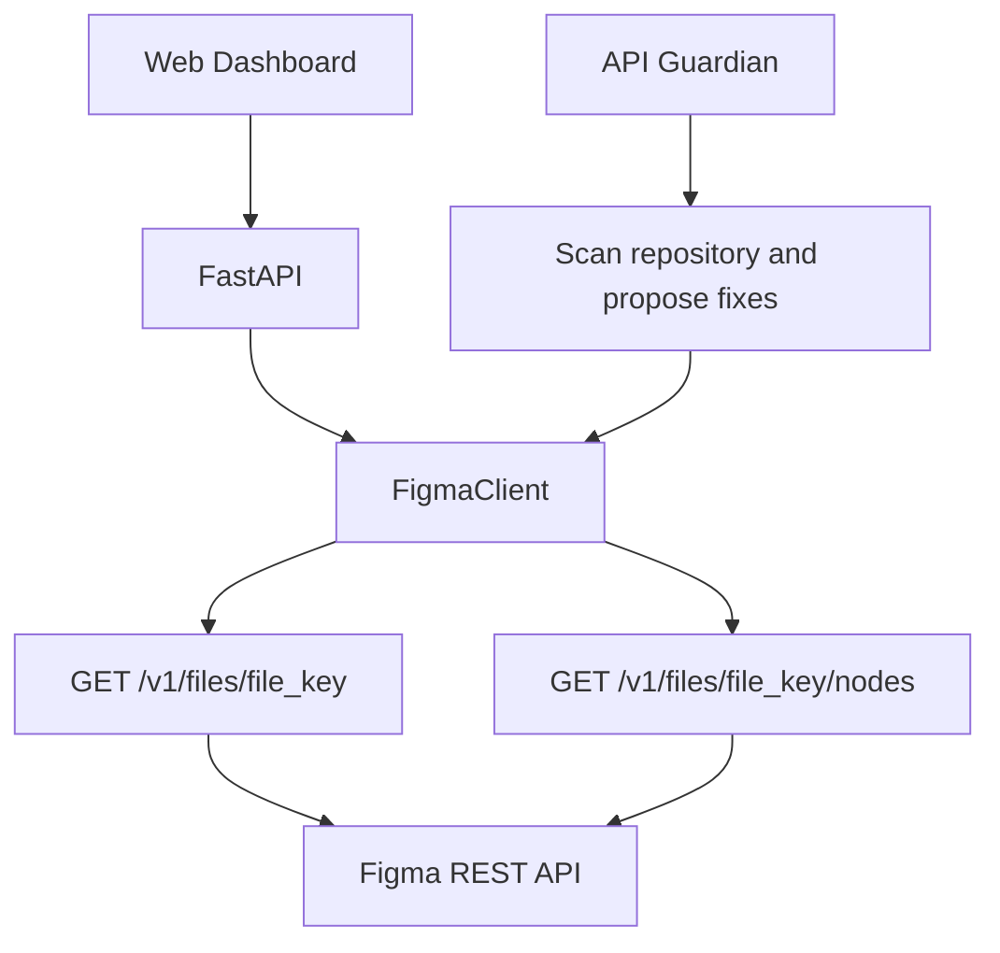

# FrameScope — Figma Design Audit Dashboard

A complete standalone FastAPI + web dashboard that calls **two distinct real Figma REST API endpoints**. Designed as a separate integration test repository for **API Guardian**.

## Two API requests

| Request | Endpoint | Function |
|---|---|---|
| 1 | `GET https://api.figma.com/v1/files/{file_key}?depth=2` | Fetch file metadata and top-level pages |
| 2 | `GET https://api.figma.com/v1/files/{file_key}/nodes?ids=1:2` | Fetch detailed information about selected nodes |

Both requests use a **real** Figma API token via `X-Figma-Token`. They are not mocks at runtime. Tests use `httpx.MockTransport` so they can run without credentials.

## Quick start (Mac)

```bash
python3 -m venv .venv
source .venv/bin/activate
python -m pip install -r requirements.txt
cp .env.example .env
```

Create a Figma personal access token in Figma account settings. Give it access to read file content (`file_content:read` scope if offered) and make sure you can access the design file in your Figma account. Edit `.env`:

```env
FIGMA_TOKEN=your_real_token_here
```

Run:

```bash
python -m pytest -q
python -m uvicorn app.main:app --reload --port 8006
```

Visit **http://127.0.0.1:8006**. Paste a Figma design file URL, click **Load file**, then use a node ID shown in the pages response and click **Inspect nodes**.

### Get a node ID

Figma node IDs are typically `1:2`, `0:1`, etc. You can also select a layer in Figma and use the `node-id` value in its URL, often encoded as `1-2`; enter it in the app as `1:2`.

## How to test API Guardian

1. Create a new GitHub repository containing this project (never commit `.env`).
2. Confirm both requests work against a real Figma file.
3. Point API Guardian at this repository. There are **two independently testable request paths** in `app/figma_client.py`: `get_file()` and `get_nodes()`.
4. For a reproducible test, create a separate test branch and deliberately introduce a controlled endpoint, parameter, or response-format incompatibility in **one or both** paths. Supply a matching migration specification to API Guardian. Confirm the repair fixes the targeted problem and both tests pass.
5. Compare diffs and validate against the real Figma API. Do not assume a fabricated change is an actual Figma deprecation.

**Important:** This project does not claim Figma recently deprecated either endpoint. They are two current integration points. To test real breaking-change detection, use a verified provider changelog; to test patching and multi-file repair, use controlled faults.

## Security

- Figma tokens are loaded server-side from `.env`, never sent to the browser.
- `.env` is ignored by Git. Only commit `.env.example`.
- Avoid pasting your token into ChatGPT, issues, commits, or screenshots.
- The app makes read-only Figma API requests.

## Architecture


